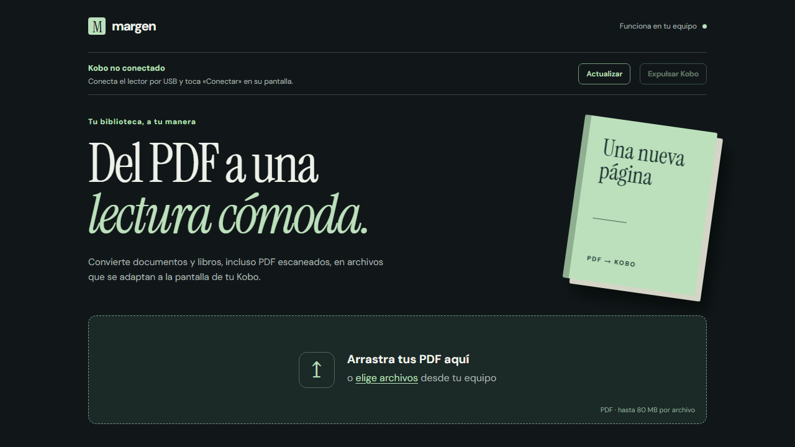

# Margen

Aplicación local para convertir PDF a EPUB refluible o KEPUB para Kobo. Admite PDF con texto seleccionable y PDF escaneados mediante OCR local en español e inglés. Los archivos se procesan en tu equipo y los resultados quedan en `outputs/`.

Puedes probar el flujo con [este PDF breve de ejemplo](examples/ejemplo.pdf), creado para el proyecto.

## Iniciar en Windows

1. Instala [Python 3.10 o posterior](https://www.python.org/downloads/windows/) con el lanzador `py`.
2. Descarga el repositorio y haz doble clic en `abrir-margen.cmd`. La primera vez ejecuta `instalar.ps1` para instalar las dependencias en `.venv/` y preparar los modelos. La descarga inicial puede tardar varios minutos.
3. Abre `http://127.0.0.1:8765` si el navegador no se abre automáticamente. En siguientes usos, basta con volver a abrir `abrir-margen.cmd`.

También puedes usar PowerShell: `powershell -ExecutionPolicy Bypass -File .\iniciar.ps1`. El inicio vuelve a ejecutar la instalación cuando cambian sus instrucciones o dependencias.

La instalación descarga [kepubify v4.0.4](https://github.com/pgaskin/kepubify/releases/tag/v4.0.4), los modelos de [Argos Translate](https://argos-translate.readthedocs.io/en/stable/), el modelo OCR latino de [RapidOCR](https://rapidai.github.io/RapidOCRDocs/main/en/model_list/), un Java Runtime portátil de [Eclipse Temurin](https://adoptium.net/) y [EPUBCheck 5.4.0](https://github.com/w3c/epubcheck/releases/tag/v5.4.0). Quedan en directorios ignorados por Git.

Arrastra uno o varios PDF y pulsa **Revisar**. La app muestra un diagnóstico de páginas escaneadas, imágenes y posibles columnas, una vista previa editable de las tres primeras páginas y los nombres de las secciones. Después pulsa **Iniciar conversión**. Verás el progreso, podrás cancelar y encontrarás los archivos terminados en el historial local.

Puedes elegir EPUB o KEPUB, traducir el texto de español a inglés o viceversa, ajustar título y autor, y conservar portada, índice e imágenes. Si eliges KEPUB, la app ofrece descargar tanto el KEPUB (`.kepub.epub`, nombre esperado por Kobo) como el EPUB normal. La traducción y el OCR se ejecutan localmente; un libro largo o escaneado puede tardar varios minutos. Cada EPUB se valida antes de entregarlo. La app usa EPUBCheck cuando la instalación está completa, y aplica una comprobación estructural si EPUBCheck no está disponible.

## Enviar al Kobo por USB

Conecta el Kobo al ordenador y toca **Conectar** en la pantalla del lector. La app comprueba periódicamente si aparece una unidad Kobo; también puedes pulsar **Actualizar**. Después de convertir, pulsa **Enviar al Kobo** junto al libro. El archivo se copia a la carpeta principal de la unidad y la app muestra la ruta final. Si ya existe otro libro con ese nombre, crea una copia numerada sin reemplazar el anterior. [Expulsa el dispositivo de forma segura](https://help.kobo.com/hc/en-us/articles/360017765933-Eject-your-Kobo-eReader-when-connected-to-a-computer) antes de desconectarlo. La detección requiere que el lector esté montado como unidad y tenga su carpeta `.kobo`.

En Windows puedes pulsar **Expulsar Kobo** en la app. Usa la acción de expulsión de Windows sobre la unidad Kobo seleccionada y espera a que el sistema la retire. Solo cuando la app confirme la expulsión debes desconectar el cable. Si Windows indica que hay archivos abiertos o no confirma la expulsión, ciérralos y vuelve a intentar.

## Alcance

- Acepta PDF de hasta 80 MB por archivo. El OCR intenta convertir páginas escaneadas a texto adaptable.
- Usa los marcadores de capítulos del PDF si existen.
- Si el PDF no tiene índice, divide el libro en secciones manejables y conserva los encabezados detectados. La portada generada usa título y autor, no una captura de la página del PDF.
- Quita encabezados y pies repetidos, une palabras cortadas entre líneas y conserva bloques de código monoespaciado.
- La maquetación de dos columnas, tablas complejas y notas al pie puede requerir retoques posteriores. La vista previa señala posibles columnas.
- El OCR puede cometer errores; revisa especialmente acentos, tablas y páginas con poco contraste.
- La traducción automática puede necesitar revisión, especialmente en nombres propios, expresiones y documentos con columnas. Las imágenes y la portada no se traducen.
- El servidor escucha solo en `127.0.0.1`.

## Desarrollo

Ejecuta las pruebas con `.venv\Scripts\python.exe -m unittest discover -s tests -v`. El código del proyecto se publica bajo la [licencia MIT](LICENSE). Las herramientas y modelos que descarga la instalación conservan sus licencias propias.
